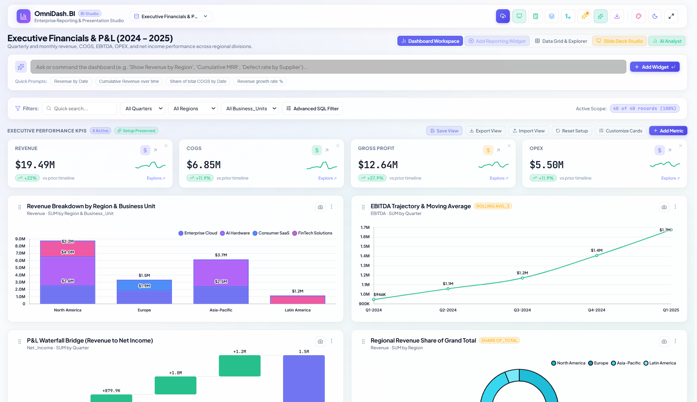
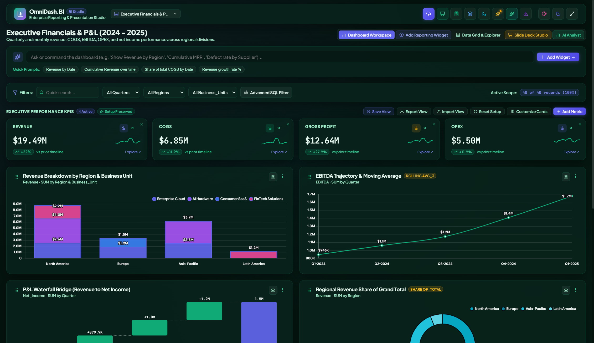
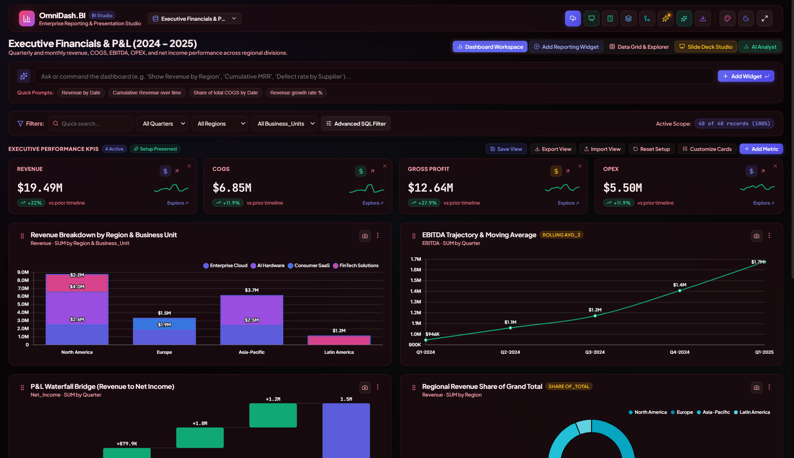

# OmniDash — Data Analyser and Visualiser 📊

> **Enterprise-Grade, Zero-Cloud Business Intelligence & Presentation Deck Studio**  
> Run instantly as a **Standalone Single-File HTML App** (no installation needed) or as a **Full React 19 + Vite Application**.

[](https://react.dev)
[](https://vitejs.dev)
[](https://www.chartjs.org)
[](https://github.com/navzar81-dev/Omni-Dash---Data-Analyser-and-Visualiser)
[](https://opensource.org/licenses/MIT)

---

## 📸 Key Screenshots & Interface Preview

### 1. Executive Boardroom Dashboard (Midnight Cyber Theme)


### 2. High-Clarity Corporate Light Theme


### 3. Sapphire Ocean Executive Theme


### 4. Emerald Wealth & Financial Theme


### 5. Obsidian Crimson Dark Theme


### 6. Relational Data Modeling & Hash Joins Studio


### 7. Calculated Field & Custom Formula Engine


### 8. Automated Data Profiling & Schema Health


---

## ⚡ Two Ways to Run OmniDash

OmniDash is architected to give you complete freedom in how you deploy and use it:

### 🌟 Option 1: Instant Standalone Single-File HTML (Zero Setup)
**No Node.js, no terminal, no server required!**

1. Download or clone this repository.
2. Locate [`OmniDash_Business_Analytics_Standalone.html`](./OmniDash_Business_Analytics_Standalone.html) in the root directory (or inside [`OmniDash_Email_Package/`](./OmniDash_Email_Package/)).
3. **Double-click to open it in Chrome, Edge, Safari, Firefox, or Brave.**
4. The entire dashboard, Chart.js engine, Excel/PDF/DOCX/PPTX parsers, and local storage run **100% locally in your browser sandbox**. It is completely air-gapped, offline-ready, and safe to email as an attachment.

---

### 🚀 Option 2: Full Developer React App (Vite + Modular Source)
For custom modifications, feature extensions, and developers:

#### Prerequisites
* [Node.js](https://nodejs.org/) (version 18+ recommended)
* `npm` or `yarn` / `pnpm`

#### 1. Clone & Install Dependencies
```bash
git clone https://github.com/navzar81-dev/Omni-Dash---Data-Analyser-and-Visualiser.git
cd Omni-Dash---Data-Analyser-and-Visualiser
npm install
```

#### 2. Start Local Development Server
```bash
npm run dev
```
Open your browser at `http://localhost:5173`.

#### 3. Production Build
```bash
# Standard multi-chunk production bundle (in /dist)
npm run build

# Or generate the single-file self-contained HTML bundle (in /dist_singlefile)
npm run build:singlefile
```

---

## 🌟 Core Feature Suite

### 1. Universal Multi-Format Data Ingestion
Drop any business file directly into OmniDash—the built-in heuristic parser auto-detects dimensions, continuous measures, and date columns:
* 📑 **Excel Spreadsheets**: `.xlsx`, `.xls` (multi-sheet selector via SheetJS)
* 📊 **Delimited Files**: `.csv`, `.tsv`, `.txt` with automatic delimiter sniffing and encoding detection (`utf-8`, `utf-16`, `cp1252`, BOM)
* 📝 **Word Documents**: `.docx` (automatically extracts embedded table grids and XML records)
* 📽️ **PowerPoint Presentations**: `.pptx` (reconstructs tabular data from slide shapes)
* 📄 **PDF Documents**: `.pdf` (vertical coordinate clustering extracts structured records)
* 📋 **Direct Clipboard Paste**: Paste raw JSON or tab-separated text straight from spreadsheets

### 2. Relational Data Modeling & Joins
Enrich datasets and merge multiple sources directly inside the browser:
* **$O(N+M)$ Hash Joins**: `LEFT JOIN`, `INNER JOIN`, `FULL OUTER JOIN`, and `CROSS JOIN`
* **Source Flexibility**: Join your primary dataset against preloaded industry datasets (SaaS, Healthcare, E-Commerce) or upload a secondary file on the fly
* **Collision Resolution**: Automatic prefixing for overlapping columns (e.g. `B_Revenue`)
* **Simulation Studio**: Real-time match rate counters, unmatched row metrics, and live tabular preview

### 3. Custom Bins & Dimension Bucketing
* **Continuous Numeric Brackets**: Convert continuous numbers into discrete bins (auto-generated Tertiles, Quartiles, Deciles, or custom user brackets)
* **Categorical Group Mapping**: Combine dozens of discrete values into macro segments (e.g., group country codes into custom sales territories)
* **Immediate Schema Injection**: Created buckets become first-class dimensions available across all chart widgets

### 4. Interactive Drag-and-Drop Dashboard
* **Drag-and-Drop Reordering**: Grab widget handles to rearrange cards dynamically; layout is automatically saved to browser storage
* **5-Tier Width Spans**: Easily scale widgets between Quarter (`1/4`), Third (`1/3`), Half (`1/2`), Two-Thirds (`2/3`), and Full (`12 cols`)
* **10+ Chart Types**: Bar, Line, Area, Stacked Bar, Donut, Pie, Radar, Polar Area, P&L Waterfall Bridge, Target Attainment Gauges, and Cross-Tabulation Pivot Matrices

### 5. Advanced SQL-Like Compound Filtering
* **Visual Rule Builder**: Compound filtering with `ALL (AND)` or `ANY (OR)` logic
* **13 Operators**: `=`, `!=`, `>`, `>=`, `<`, `<=`, `BETWEEN`, `CONTAINS`, `NOT CONTAINS`, `STARTS WITH`, `IN`, `IS EMPTY`, and `IS NOT EMPTY`
* **Live Matching Statistics**: Real-time counter displays matched rows and percentage coverage

### 6. 6-Theme Executive Presentation Suite & Custom Branding
* **Themes**:
  1. 🌌 **Midnight Cyber**: Deep cyber dark with glowing indigo & purple aura
  2. 🏢 **Clean Corporate**: Slate-white high-contrast palette for daytime boardroom reviews
  3. 🌲 **Wealth & Financial**: Rich dark emerald green calibrated for finance & P&L
  4. 🌊 **Sapphire Ocean**: Deep royal navy blue with electric cobalt highlights
  5. 🍷 **Obsidian Crimson**: Carbon black with ruby red highlights
  6. ⚡ **Cyberpunk Neon**: High-contrast magenta & cyan
* **Custom Brand Identity**: Upload your company logo, set dashboard titles/subtitles, and customize brand accent hex colors
* **Grid Density**: Toggle between **Spacious** (24px gap) and **Compact** (dense Wall-Street layout)

### 7. Offline Local AI Business Analyst
* **Tier 1 (In-Browser WebAssembly)**: Run local GGUF models directly via `@wllama/wllama` without sending data across the network
* **Tier 2 (AirLLM Companion Server)**: Stream large models (up to 70B parameters) on consumer laptops using the optional Python FastAPI companion (`airllm_server.py`)
* **Tier 3 (Heuristic Reasoner)**: Instant, zero-latency rule-based statistical analysis fallback

### 8. Boardroom Presentation Studio & Multi-Format Export
* 📽️ **PowerPoint (`.pptx`)**: Generates styled slide decks with KPIs, charts, and executive insights via `PptxGenJS`
* 📑 **Executive PDF**: Multi-page vectorized PDF reports (`jsPDF` + `html2canvas`)
* 📦 **All-Charts ZIP**: Packages every dashboard widget as high-resolution PNGs in one click
* 💾 **View Layout Backup (`.json`)**: Export and import your custom dashboard view configurations

---

## 📁 Repository Structure

```
Omni-Dash---Data-Analyser-and-Visualiser/
├── OmniDash_Business_Analytics_Standalone.html   # Zero-install portable single-file app
├── OmniDash_Email_Package/                      # Self-contained emailable distribution
│   ├── OmniDash_Business_Analytics_Standalone.html
│   ├── airllm_server.py
│   └── README.txt
├── docs/
│   └── screenshots/                             # High-resolution interface previews
├── src/
│   ├── App.jsx                                  # Master layout, state & modal orchestration
│   ├── index.css                                # Design tokens, themes & drag-and-drop styles
│   ├── components/
│   │   ├── Navbar.jsx                           # Brand header, themes, dataset switcher & actions
│   │   ├── DashboardGrid.jsx                    # Drag-and-drop responsive grid
│   │   ├── WidgetCard.jsx                       # Chart container with drag handle & 5-tier width spans
│   │   ├── WidgetBuilderModal.jsx               # Wizard to create & edit visualization widgets
│   │   ├── DataModelingModal.jsx                # Relational Joins & Category Bucketing Studio
│   │   ├── AdvancedFilterModal.jsx              # Compound SQL-like predicate filter builder
│   │   ├── BrandingModal.jsx                    # Brand logo, themes, accent color & density studio
│   │   ├── GlobalFilterBar.jsx                  # Interactive filter bar with active rule pills
│   │   ├── ExecutiveKpis.jsx                    # KPI metric summary cards with pacing & delta
│   │   ├── FormulaEngineModal.jsx               # Custom calculated field & arithmetic formula engine
│   │   ├── PresentationStudio.jsx               # Interactive slide deck designer & PPTX exporter
│   │   ├── DataProfilerModal.jsx                # Statistical distributions, null checks & data health
│   │   ├── DataTableView.jsx                    # Paginated data table explorer
│   │   ├── WaterfallChart.jsx                   # Financial P&L bridge chart
│   │   ├── PivotTableWidget.jsx                 # Cross-tabulation heatmap matrix
│   │   ├── GaugeWidget.jsx                      # Target pacing gauge widget
│   │   ├── LocalAiModal.jsx                     # Local GGUF & AirLLM model manager
│   │   └── AiAnalystDrawer.jsx                  # Local AI data chat copilot
│   └── services/
│       ├── dataModelingService.js               # Join engine, binning, and compound filter logic
│       ├── calculationEngine.js                 # Aggregations (SUM/AVG/MIN/MAX), formulas & deltas
│       ├── fileParsers.js                       # Multi-format parsing (XLSX, CSV, DOCX, PPTX, PDF)
│       ├── chartSetup.js                        # Chart.js registration & theme synchronizer
│       ├── exportService.js                     # PPTX, PDF, Excel, CSV, PNG & ZIP exporters
│       ├── localAiEngine.js                     # Wllama (WASM GGUF) and AirLLM companion connector
│       ├── sampleDatasets.js                    # Preloaded industry data (SaaS, Logistics, Healthcare)
│       ├── smartInsights.js                     # Outlier detection & trend analysis
│       └── storageService.js                    # IndexedDB & localStorage persistence layer
├── airllm_server.py                             # Optional Python FastAPI server for local 70B LLMs
├── vite.config.js                               # Standard Vite development configuration
├── vite.singlefile.config.js                    # Vite configuration for standalone HTML bundler
└── package.json                                 # Dependencies & scripts
```

---

## 🛠️ Optional: Running the AirLLM Server

If you wish to connect OmniDash to an offline open-source LLM (such as Llama 3.2 or Mistral) on a machine with limited VRAM:

```bash
# 1. Install dependencies
pip install airllm fastapi uvicorn pydantic torch

# 2. Launch the companion server
python airllm_server.py --model_path meta-llama/Llama-3.2-1B-Instruct --port 8000
```
OmniDash will automatically detect the server at `http://localhost:8000` and route AI analysis queries through it.

---

## 🔒 Security & Air-Gap Compliance

* **Zero Cloud Dependence**: OmniDash sends no telemetry, tracking, or raw customer data to external servers.
* **Safe Local Storage**: Uses client-side `IndexedDB` (`OmniDash_BI_Storage`) to persist large datasets safely without hitting browser quota limits.
* **Isolated Browser Sandbox**: All parsing (including PDF and Word extraction) executes purely inside WebAssembly and client-side JavaScript.

---

## 📄 License

This project is licensed under the [MIT License](LICENSE).
