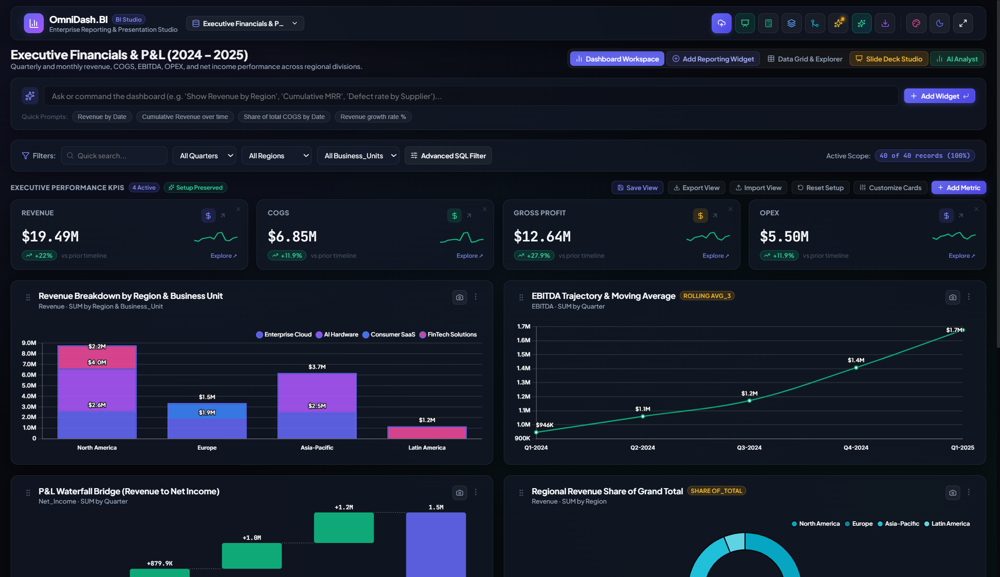
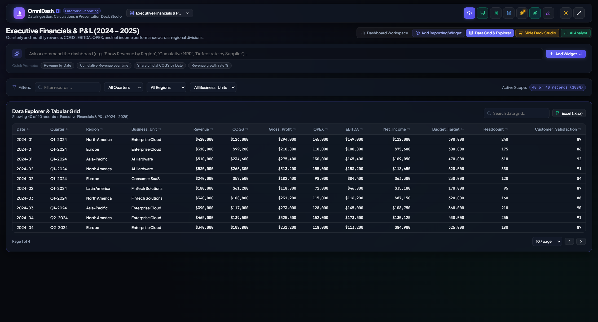
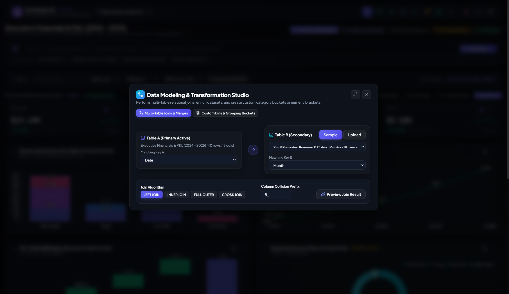
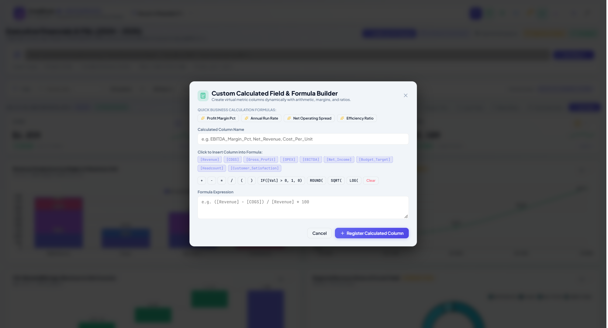
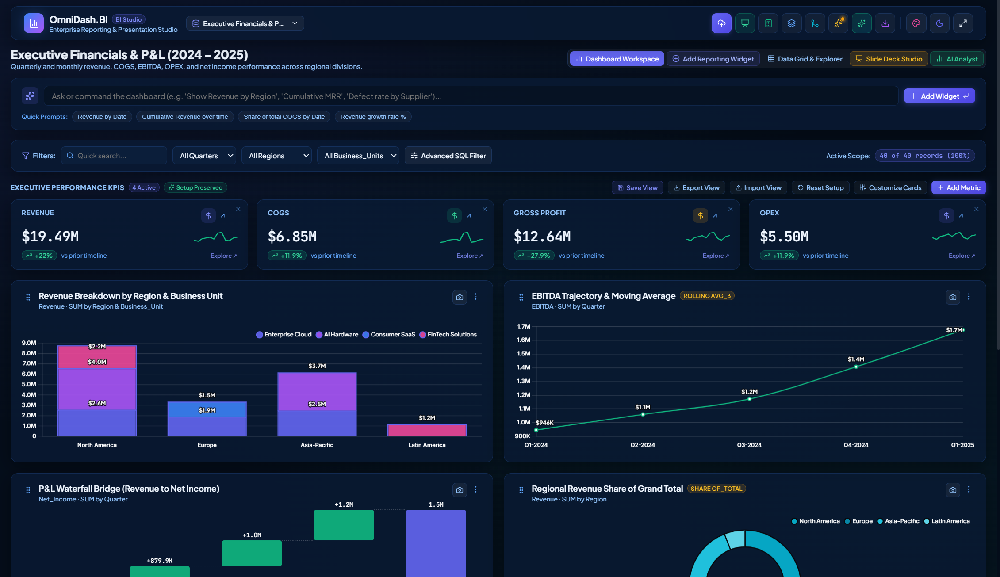
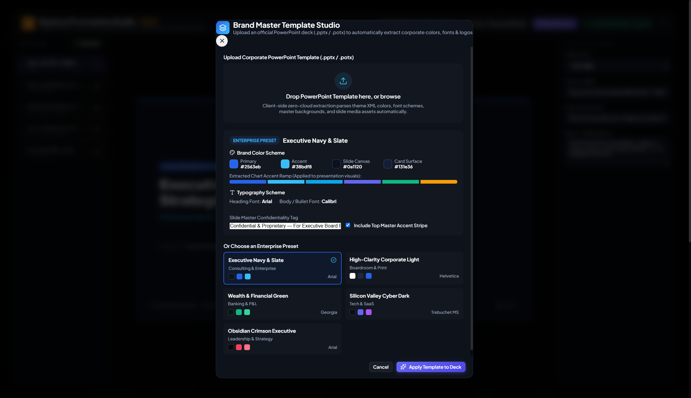
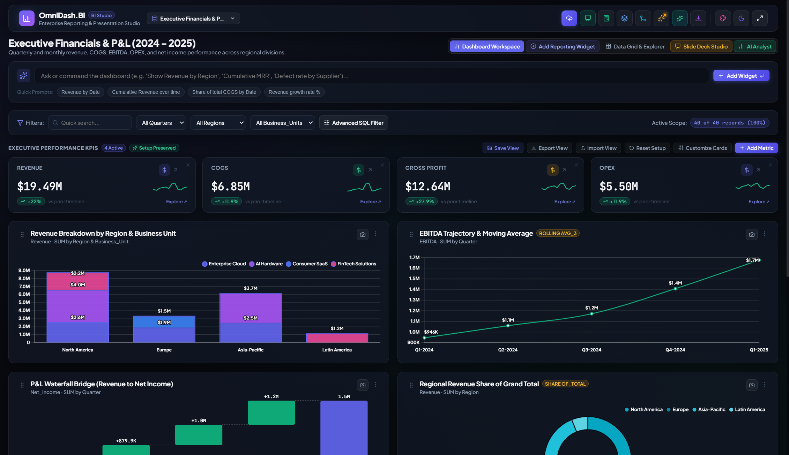

# OmniDash — End-to-End User Guide & Architecture Reference 📊

> **The Definitive Manual for Business Analysts, Financial Controllers, Executives, and Data Practitioners**  
> *Version: 2.0.0 · Platform: Zero-Backend In-Browser Business Intelligence*

---

## Table of Contents

1. [Platform Overview & Core Architecture Philosophy](#1-platform-overview--core-architecture-philosophy)
2. [Data Ingestion, Profiling & Auto-Cleaning](#2-data-ingestion-profiling--auto-cleaning)
3. [Data Modeling Studio & Formula Engine](#3-data-modeling-studio--formula-engine)
4. [Executive KPI Management & Metric Math](#4-executive-kpi-management--metric-math)
5. [Visual Analytics & Chart Customization](#5-visual-analytics--chart-customization)
6. [On-Device AI Business Analyst (WASM Engine)](#6-on-device-ai-business-analyst-wasm-engine)
7. [Corporate Brand Master Template Studio](#7-corporate-brand-master-template-studio)
8. [Presentation Studio & Boardroom Export](#8-presentation-studio--boardroom-export)
9. [Local Drive Sync (Google Drive / OneDrive) & Workspace Hub](#9-local-drive-sync-google-drive--onedrive--workspace-hub)
10. [Workspace Persistence, Privacy & Performance Guidelines](#10-workspace-persistence-privacy--performance-guidelines)
11. [Frequently Asked Questions (FAQ) & Troubleshooting](#11-frequently-asked-questions-faq--troubleshooting)

---

## 1. Platform Overview & Core Architecture Philosophy

### 1.1 What is OmniDash?
OmniDash is an enterprise-grade business intelligence, statistical modeling, and boardroom presentation platform that runs **entirely in the user's web browser**. It merges the analytical depth of Power BI and Tableau with the visual polish of modern slide decks, all without requiring servers, cloud databases, API subscriptions, or software installations.



### 1.2 Core Architectural Principles & Behind-the-Scenes Mechanics

#### **A. Zero-Cloud / 100% Privacy-Preserving Runtime**
Traditional business intelligence platforms (e.g., Salesforce Tableau, Microsoft Power BI Cloud, Google Looker) require uploading confidential spreadsheets and databases to external cloud servers. For financial institutions, healthcare providers, and proprietary enterprises, this introduces data governance hurdles, compliance risks, and privacy review cycles.

* **Behind the Scenes**: OmniDash executes within the **browser JavaScript runtime sandbox**. 
  - Every calculation, aggregations, chart rendering, and formula evaluation happens in client-side memory (`RAM`).
  - Raw records, financial statements, and employee information **never cross the network wire**.
  - All network traffic is strictly zero (except when optionally pulling quantized AI models once for offline local caching).

#### **B. Standalone Single-File Distribution**
OmniDash can be packaged into a single, self-contained HTML file (`OmniDash_Business_Analytics_Standalone.html`, ~3 MB).
* **Behind the Scenes**: Leveraging `vite-plugin-singlefile`, all React code, Lucide icons, Chart.js modules, SheetJS Excel parsers, PDF engine, OpenXML template extractors, and CSS styles are inlined as base64-encoded bundles directly inside one file.
* **Why this matters**: You can save it on a USB stick, air-gap it on an offline laptop, or email it to a CFO or client as a regular file attachment. They simply double-click the file, and the entire BI suite launches instantly in any modern browser (Chrome, Edge, Safari, Firefox).

#### **C. Client-Side Persistence Architecture**
OmniDash implements a two-tier persistent storage layer:
1. **IndexedDB**: High-capacity client-side structured storage for uploaded tabular records, merged datasets, and custom views.
2. **LocalStorage**: Fast key-value store for workspace layout preferences, pinned widgets, filter state, active color themes, and custom brand templates.
* **Behind the Scenes**: Storage persistence is decoupled and debounced (400ms buffer). Keystrokes in search filters or quick card resizing operate in pure memory and write asynchronously to storage without frame drops or UI freezing.

---

## 2. Data Ingestion, Profiling & Auto-Cleaning

### 2.1 Supported File Formats
OmniDash provides a universal file ingestion pipeline that accepts:
* **Excel Workbooks** (`.xlsx`, `.xls`, `.xlsm`, `.xlsb`): Full support for multi-worksheet workbooks, macro-enabled spreadsheets, and compressed binary workbooks with automated sheet discovery.
* **Delimited Files** (`.csv`, `.tsv`, `.txt`): Powered by PapaParse with automatic delimiter inference (comma, tab, semicolon, pipe).
* **Word Documents** (`.docx`): Automatically extracts embedded tables and structured data matrices from Word documents.
* **PowerPoint Presentations** (`.pptx`): Extracts embedded slide tables and OpenXML data sheets.
* **PDF Reports** (`.pdf`): Scans structured text tables from PDF documents and transforms them into analytical datasets.
* **Structured JSON** (`.json`): Flattens array-of-objects schemas automatically into clean tabular formats.

### 2.2 Multi-Worksheet Recognition & Ingestion
When an Excel workbook containing multiple worksheets is uploaded, OmniDash eliminates the limitation of defaulting solely to the first tab:
* **Interactive Worksheet Selection**: An interactive **Worksheet Navigation Bar** appears inside the Upload Modal, displaying each sheet's name and estimated row count (e.g. `📄 Q1 Sales (~1,420 rows)`, `📄 Dim_Customers (~320 rows)`).
* **Live Sheet Switching**: Clicking any worksheet tab immediately switches the preview table and statistical column profiles in real time without re-reading the file from disk.
* **"Union All Sheets" Action**: For files partitioned into time slices or regional tabs (e.g., `Q1`, `Q2`, `Q3`, `Q4`), a single click on **Union All Sheets** appends all rows into a unified table while injecting a `_SheetName` column to track row-level source provenance.
* **Relational Data Modeling Integration**: Secondary worksheets can be ingested directly into the **Data Modeling Studio** to perform in-memory Left, Inner, Right, and Full Outer Joins.

### 2.3 Resilient Clean Data Engine: Handling Macros, Formats & Header Offsets
Real-world enterprise spreadsheets frequently suffer from formatting anomalies, macros, and decorative banners that crash standard parsers. OmniDash incorporates a specialized resilient data cleaning pipeline:

```mermaid
graph TD
    A[Raw Excel / CSV / PDF Buffer] --> B[Safe Reader: Bypasses VBA Macro Streams]
    B --> C[Merged Cell Propagation: Unmerges Spanned Header Cells]
    C --> D[Smart Banner Detector: Scans Top 15 Rows to Bypass Company Titles]
    D --> E[Summary Footer Isolator: Excludes 'Total' Rows to Prevent Double-Counting]
    E --> F[Value Sanitizer: Converts (1,200) to -1200, Sanitizes #REF! to null]
    F --> G[Statistical Profiling: Measure vs Date vs Dimension Inference]
```

1. **VBA Macro Bypassing (`.xlsm` / `.xlsb`)**:
   - Macro-enabled workbooks often trigger security warnings or parser failures. OmniDash's engine safely extracts cell data tables while completely ignoring the VBA bytecode stream (`vbaProject.bin`).
2. **Smart Banner Header Detection**:
   - Business spreadsheets frequently place company logos, title banners, or confidentiality notices across rows 1–3 (e.g., *"ACME Corp Financial Report"*), pushing the true column headers to row 4 or 5.
   - The engine scans the first 15 rows using a scoring heuristic (evaluating string density, column distinctness, and subsequent row alignment) to automatically align the true header row and bypass decorative titles.
3. **Accounting Negatives Normalization**:
   - Financial P&L statements format negative values in parentheses (e.g., `(1,234.56)` or `($5,000.00)`), which JavaScript native parsing converts to `NaN`.
   - OmniDash automatically parses accounting parentheses and converts them into true floating-point negatives (`-1234.56`, `-5000.00`).
4. **Currency & Special Character Stripping**:
   - International currency symbols (`$`, `€`, `£`, `¥`, `₹`, `₽`, `₩`, `CHF`), percentage signs (`%`), thousands commas, and invisible unicode whitespace (`\u00A0`, `\u200B`) are sanitized automatically.
5. **Excel Formula Error Sanitization**:
   - Broken formulas resulting in `#REF!`, `#DIV/0!`, `#N/A`, `#VALUE!`, `#NAME?`, `#NUM!`, or `#NULL!` are converted cleanly to `null` so downstream charts, KPIs, and calculated formulas do not fail.
6. **Summary / Grand Total Footer Isolation**:
   - Tables frequently conclude with a summary row (e.g. `Total`, `Grand Total`, or `Average`). Leaving these rows in the dataset inflates aggregations by 2x.
   - OmniDash identifies footer summary rows, logs them in the cleaning audit, and isolates them from the analytical dataset to guarantee exact mathematical accuracy.
7. **Merged Header Cell Propagation**:
   - Merged header cells (such as "Q1 Actuals" merged across 3 sub-columns) are automatically unmerged and replicated across child column ranges.

### 2.4 Built-In Sample Datasets
For instant testing and evaluation, OmniDash includes four pre-loaded enterprise datasets:
1. **Enterprise Financials**: Quarterly revenue, cost of goods sold (COGS), operating expenses (OPEX), EBITDA, net margins, regions, and business divisions.
2. **SaaS Product Analytics**: Monthly recurring revenue (MRR), churn rate, customer acquisition cost (CAC), lifetime value (LTV), user seats, and engagement tiers.
3. **Omnichannel Retail Sales**: Store traffic, SKU category volumes, discounts, gross merchandise value (GMV), return rates, and shipping times.
4. **Manufacturing & Supply Chain**: Production yields, defect rates, machine downtime, warehouse utilization, and operational cycle times.



---

## 3. Data Modeling Studio & Formula Engine



### 3.1 Relational Hash Joins (Multi-Table Merging)
Often business answers require combining two distinct files—such as joining an **Orders** table with a **Customer Demographics** spreadsheet, or merging **Actuals** with **Budget Targets**.

#### How to Join Datasets in OmniDash:
1. Click **Data Modeling** in the top navigation bar.
2. Under **Merge Secondary Dataset**, upload or select your second table.
3. Choose the **Join Type**:
   - **Inner Join**: Keeps only records where the join key matches in both tables.
   - **Left Outer Join** *(Most Common)*: Keeps all primary table records, matching data from the secondary table where available.
   - **Right Outer Join**: Keeps all records from the secondary table.
   - **Full Outer Join**: Retains all rows from both datasets.
4. Select the matching key column in Table A and Table B (e.g., `CustomerID == Customer_ID`).
5. Click **Execute In-Memory Merge**. OmniDash produces a unified consolidated dataset ready for visualization.

* **Behind the Scenes**: Executes an in-memory **Hash Join** ($O(N + M)$ algorithmic complexity). A lookup hash map is constructed from the smaller dataset, allowing large tables (50,000+ rows) to merge in less than 50 milliseconds directly in browser RAM.

---

### 3.2 Advanced Compound Filtering Engine
The **Advanced Filters** dialog allows building multi-layer logic rules across multiple columns simultaneously:
* **Condition Operators**: Equals, Does Not Equal, Greater Than (`>`), Less Than (`<`), Contains, Starts With, Is Blank, Is Not Blank.
* **Boolean Logic**: Toggle between `AND` (all rules must be satisfied) and `OR` (any rule can match).
* **Safe State Reset**: When switching between different datasets, compound rules are automatically cleared to avoid filtering out newly loaded data.

---

### 3.3 Custom Formula & Calculated Fields Engine



OmniDash includes an Excel-like formula builder that adds calculated columns to your dataset on the fly.

#### Formula Syntax & Token Substitution:
Columns are referenced in square brackets: `[ColumnName]`.

| Formula Pattern | Example Expression | Real-World Use Case |
|---|---|---|
| **Arithmetic** | `[Revenue] - [COGS]` | Gross Profit calculation |
| **Percentages & Margins** | `(([Revenue] - [COGS]) / [Revenue]) * 100` | Gross Margin % |
| **Conditional Logic** | `IF([Profit] > 0, [Revenue] * 0.05, 0)` | Sales commission calculation |
| **Multi-Argument Limits** | `MIN([Revenue], [Target])` | Capped performance quota |
| **Floor / Benchmark** | `MAX([COGS], 1000)` | Enforcing baseline expense thresholds |
| **Mathematical Functions** | `ROUND(SQRT([Variance]), 2)` | Volatility & variance metrics |

#### Supported Formula Functions:
- `+`, `-`, `*`, `/`, `(` , `)`: Standard arithmetic precedence.
- `IF(condition, true_value, false_value)`: Ternary conditional branching.
- `MIN(a, b)` / `MAX(a, b)`: Multi-argument boundary clipping.
- `ROUND(val, decimals)`: Standard precision rounding.
- `ABS(val)`: Absolute positive value.
- `SQRT(val)`: Square root.
- `LOG(val)` / `LN(val)`: Base-10 and natural logarithms.

* **Behind the Scenes (Security & Execution)**: User formulas are verified against a strict lexical character allowlist to eliminate code injection vectors. The engine compiles the expression into a vectorized row evaluator function, processing thousands of records with zero DOM lag.

---

## 4. Executive KPI Management & Metric Math

At the top of the dashboard sits the **Executive Scorecard**, displaying critical business velocity metrics at a glance.



### 4.1 Configuring KPI Cards
Click the **Manage KPIs** button on the scorecard to:
- Add or remove metrics from the scorecard.
- Edit the display label (e.g., change `cogs_total` to `Cost of Goods Sold`).
- Choose aggregation methods: `SUM`, `AVG`, `MAX`, `MIN`, `COUNT`.
- Assign explicit formatting: Currency (`$`), Percentage (`%`), or Integer Number.

### 4.2 Period-Over-Period Delta & Sparklines
Each KPI card displays:
1. **Headline Value**: Formatted total with compact abbreviations (`$14.2M`, `840K`, `68.5%`).
2. **Delta Indicator**: Period-over-period percentage difference with color-coded positive (green) or negative (rose) badges.
3. **Miniature Sparkline**: 12-point trendline showing historical trajectory over time.

* **Behind the Scenes (Data Accuracy Fix)**:
  - Dates are parsed as true timestamps (`Date.parse()`) rather than alphanumeric strings, guaranteeing that dates like `1/15/2024` are placed chronologically before `2/1/2024`.
  - The dataset is divided chronologically into historical baseline vs. recent periods.
  - When a prior period baseline is zero, the delta is safely capped at $\pm 100\%$ rather than triggering an artificial division-by-one inflation (which previously caused inaccurate $+9900\%$ outputs).

### 4.3 Interactive KPI Deep-Dive Visualizer
Clicking any KPI card opens the **KPI Detail Modal**:
* **Distribution Quantiles**: Shows Median, 25th percentile, 75th percentile, Min, and Max.
* **Rolling Velocity**: Moving average trendline smoothing out short-term fluctuations.
* **Top Contributors**: Breakdown of which categorical dimension drove the largest share of this KPI.
* **One-Click Pin to Dashboard**: Transform any deep-dive chart into a permanent widget card with a single click.

---

## 5. Visual Analytics & Chart Customization

### 5.1 Supported Chart Types
OmniDash provides 10 specialized visualization engines powered by Chart.js 4.5:

| Chart Type | Best Suited For | Custom Capabilities |
|---|---|---|
| **Line Chart** | Temporal trends, sales trajectory, forecasting | Smooth cubic splines, chronological axis, rolling averages |
| **Bar Chart** | Categorical comparisons (Region, Product, Rep) | Vertical or horizontal orientation, sorted by value or name |
| **Stacked / Grouped Bar** | Multi-dimensional breakdowns (Region by Quarter) | Secondary dimension grouping with automatic legend toggle |
| **Donut / Ring** | Proportionate share, portfolio allocation | Cutout radius, hover expansion, percentage tooltips |
| **Area Chart** | Cumulative volume, cash flow progression | Translucent gradient fills, boundary clipping |
| **Radar Chart** | Competitor benchmarking, multi-variable scorecards | Web grid with customizable accent polygons |
| **Polar Area** | Cyclical or seasonal magnitude comparisons | Radial angular segments with high-contrast borders |
| **Waterfall Chart** | Net profit walk, budget variance, EBITDA breakdown | Starting pillars, delta steps, automatic `Net Total` pillar |
| **Gauge / Semi-Donut** | Target attainment, SLA tracking, utilization % | Target indicators with color-coded performance bands |
| **Pivot Table Matrix** | Two-dimensional cross-tabulations (Dept x Year) | Heatmap cell shading, true row/col mathematical averages |

---

### 5.2 Behind the Scenes: Statistical Calculation Engine

#### **A. Grouped MEDIAN Aggregation**
When analyzing skewed data (such as compensation, deal sizes, or transaction amounts), `AVG` is often distorted by extreme outliers. OmniDash supports `MEDIAN` as a native aggregation.
* **Behind the Scenes**: For both single series and grouped multi-series charts, values in each dimensional bucket are collected into numerical arrays, sorted ascendingly, and computed via median midpoint selection ($O(N \log N)$), rather than falling back to row counts.

#### **B. Waterfall Step Accumulation Logic**
Waterfall charts illustrate how an initial balance moves up and down across periods to reach a final total.
* **Behind the Scenes**: OmniDash tracks cumulative step deltas sequentially. Every intermediate period’s positive or negative shift is preserved in the running total. If the underlying data lacks a designated closing balance, an accurate **`Net Total`** pillar is automatically calculated and cleanly rendered at the end of the waterfall walk.

#### **C. Pivot Table Averages**
In cross-tabular matrices, a common software bug is taking the "average of averages" across table cells.
* **Behind the Scenes**: When `AVG` mode is selected in the OmniDash Pivot Table, the row totals, column totals, and grand total aggregate across the **raw underlying data points** for that row or column, guaranteeing mathematically rigorous enterprise accounting.

---

### 5.3 Executive Ergonomics & High-Contrast Visual Design
* **High-Contrast Black Typography (Light Theme)**:
  - Designed for high-glare environments, executive projectors, and printed handouts, the Light Theme applies pure solid black (`#000000 !important`) typography across all headers (`h1`–`h6`), descriptive sub-headers, KPI titles, modal labels, and table column headers. This eliminates low-contrast grey text and ensures crisp optical legibility.
* **Unified Accordion Action Toolbar**:
  - The primary navbar features expanding accordion action tabs (*Upload Data*, *Presentation Studio*, *Calculated Field*, *Data Profiler*, *Data Modeling*, *Smart Insights*, *AI Analyst*, *Drive Sync*, *Export*).
  - **Collapsed State**: Renders in an understated, subtle brand blue tone (`rgba(99, 102, 241, 0.12)`) with a clean blue icon indicator.
  - **Expanded & Active State**: Across **both Light and Dark themes**, hovering or expanding an action tab activates a uniform royal blue gradient (`#6366f1` / `#4f46e5`) with solid white font (`#ffffff`) and white icons, matching the visual identity of the active *Dashboard Workspace* pill.

---

### 5.4 Widget Spotlight Zoom & Underlying Data Table Inspection
To facilitate granular inspection of complex multi-series trends, crowded categorical bars, or dense pivot tables, OmniDash provides an **Executive Spotlight Zoom Lightbox**:

* **How to Trigger**:
  - Click the **Maximize / Zoom** icon button in the top-right header of any reporting widget card.
  - Alternatively, **double-click** anywhere on the widget card header.
* **Widescreen High-Resolution Canvas (94vw × 90vh)**:
  - Dynamically re-renders the chart in large widescreen format, providing spacious axis labeling, expanded splines, and high-contrast tooltip fidelity.
* **Executive Summary Metrics Strip**:
  - Prominently calculates five statistical velocity metrics for the active chart:
    - **Series Total**: Formatted aggregate sum.
    - **Category Average**: Mean value per category/bucket.
    - **Peak Point**: Highest point value and its corresponding category label.
    - **Trough Point**: Lowest point value and its corresponding category label.
    - **Categories/Points Count**: Total distinct observation count.
* **Underlying Data Table Toggle**:
  - Switch seamlessly between `[ 📈 Chart View ]` and `[ 📋 Underlying Data Table ]`.
  - The tabular view features live real-time search filtering, column sorting on click, category attribution, formatted values, and dynamic **Share of Total %** calculations.
  - Dedicated **Export CSV** button downloads the widget's underlying aggregated records directly.
* **Full-Density Data Labels with Smart Anti-Collision Guardrail**:
  - In standard dashboard grid cards, OmniDash applies smart density throttling to keep compact tiles clean and decluttered.
  - When opened in the **Spotlight Zoom Lightbox**, the engine automatically activates full data label density, displaying exact values atop every bar or line point across the widescreen canvas.
  - If a dataset is exceptionally dense (e.g., 60–100+ categories) where text would physically overlap, the pixel bounding-box collision guardrail gracefully suppresses only the colliding labels, while mouseover tooltips and the **Underlying Data Table** tab provide instantaneous access to every exact figure.
* **Keyboard & Close Controls**:
  - Pressing `ESC`, clicking the minimize button, or clicking the backdrop overlay smoothly returns to the exact dashboard view.
* **In-Card Grid Width Selection Preserved**:
  - Users can also adjust individual grid card widths directly on the dashboard (`1/4`, `1/3`, `1/2`, `2/3`, `Full Span 12`) via the card options dropdown.

---

## 6. On-Device AI Business Analyst (WASM Engine)

OmniDash includes an on-device Artificial Intelligence assistant capable of answering natural language business questions, discovering anomalies, and summarizing strategic insights.

### 6.1 Private, Zero-Cloud Inference
* **How it works**: Uses `@wllama/wllama` to run lightweight, highly quantized Large Language Models (in `.gguf` format) directly inside browser WebAssembly.
* **Why it matters**: Your company's sensitive financials, customer lists, and strategic records **never leave your personal machine**. There are no OpenAI API keys required, no monthly token bills, and no third-party data tracking.

### 6.2 One-Click "Add Slide with AI Analysis"
When the AI Business Analyst provides an executive synthesis (e.g. highlighting margin leakage in European divisions or accelerating customer acquisition velocity):
1. Click the **Add Slide with AI Analysis** button below the message.
2. OmniDash automatically parses the AI response into structured executive takeaways and bullet points.
3. The **Presentation Studio** opens immediately with a newly generated, boardroom-ready **AI Strategic Intelligence Findings** slide appended to your deck.

---

## 7. Corporate Brand Master Template Studio

Corporate presentations must adhere to strict brand guidelines (company colors, official logos, approved fonts, and slide layouts).



### 7.1 Importing PowerPoint Brand Templates (`.pptx` / `.potx`)
1. Click **Branding & Templates** in the navigation bar.
2. Drag and drop your company’s official PowerPoint template file (`.pptx` or `.potx`) into the drop zone.
3. OmniDash immediately parses the OpenXML package and extracts:
   - **Corporate Color Palette**: Primary brand color, secondary accent, surface background, and contrast text.
   - **Slide Canvas Background**: Dark mode or crisp white/light canvas theme.
   - **Brand Typography**: Heading font (e.g., Montserrat, Segoe UI, Arial) and Body font.
   - **Company Logo**: High-resolution vector or PNG emblem.
   - **Legal Disclaimer**: Automatic footer confidentiality notice.

### 7.2 Live Theme Reskinning
Once applied, the brand system automatically reskins both the **Live Interactive Dashboard** and the **Presentation Studio**. Charts dynamically adopt the corporate accent palette, and widgets mirror the company's official visual identity.

---

## 8. Presentation Studio & Boardroom Export



The **Presentation Studio** bridges the gap between interactive data exploration and high-stakes executive briefings. Instead of taking manual screenshots and pasting them into PowerPoint, OmniDash auto-generates a synchronized 16:9 widescreen presentation deck.

### 8.1 Executive Slide Layouts
1. **Title Slide**: Clean boardroom cover with company metadata, presenter credentials, report date, and corporate accent stripe.
2. **KPI Spotlight Scorecard**: Four high-level metric cards paired with strategic narrative bullet points.
3. **Split Visual + Insights**: 60% live chart embed on the left; 40% glassmorphic executive takeaway findings on the right.
4. **Full Chart Visualizer**: Edge-to-edge chart display for detailed trajectory and cohort analysis.
5. **Strategic Conclusions**: Numbered action directives, board recommendations, and next-quarter initiatives.

### 8.2 Presenter Mode & Live Synchronization
- **Fullscreen Projection**: Click **Present** to project the deck in distraction-free 16:9 fullscreen.
- **Private Speaker Talking Notes**: Access personal speaker talking points with keyboard shortcuts (Arrow keys, Spacebar, ESC).
- **"Sync Live" Button**: Updated your dashboard filters or loaded new monthly numbers? Click **Sync Live** in the slide list header to instantly refresh the presentation deck with current metrics without rebuilding slides from scratch.

### 8.3 High-Fidelity Boardroom Exports

```
Export Capabilities:
├── PowerPoint (.pptx)        -> Real OpenXML shapes, editable text, brand palettes, embedded charts
├── Multi-Page PDF Deck       -> Complete 16:9 slide presentation compiled across all deck slides
├── Excel Workbook (.xlsx)    -> Raw records formatted as structured Excel table
├── CSV Dataset (.csv)        -> Plain-text delimited data for external ETL
├── High-Res Chart PNG        -> 2x retina snapshot of any individual card
└── All-Charts ZIP Archive    -> Packaged ZIP containing high-resolution PNGs of all active charts
```

* **Behind the Scenes (Isolated Image Capture)**:
  - Previous presentation tools often captured charts with unwanted UI buttons (drag handles, menus) or failed when viewing other tabs.
  - OmniDash features a dedicated **off-screen visual capture container**. Charts rendered for PowerPoint export use the exact corporate brand palette and canvas theme, completely isolated from dashboard controls, guaranteeing flawless slides regardless of the currently active tab.

---

## 9. Local Drive Sync (Google Drive / OneDrive) & Workspace Hub

OmniDash features native local cloud drive synchronization and one-click workspace packaging. This allows you to bind the application directly to your local **Google Drive** (`G:\My Drive` or `C:\Users\...\Google Drive`) or **Microsoft OneDrive** (`C:\Users\...\OneDrive`) folder without configuring API credentials or hosting servers.

```
┌────────────────────────────────────────────────────────────────────────┐
│                          OmniDash Drive Hub                            │
├───────────────────────┬────────────────────────┬───────────────────────┤
│    Files on Drive     │   Export to Drive      │   Restore Workspace   │
│                       │                        │                       │
│ • Sales_2024.xlsx     │ [Save Snapshot .omnidash]  Drag-and-drop       │
│ • Q3_Review.omnidash  │ [Save Filtered Excel]  │   .omnidash package   │
│ • Deck_Export.pptx    │ [Save Deck .pptx]      │   for instant restore │
└───────────────────────┴────────────────────────┴───────────────────────┘
```

### 9.1 How It Works (Behind the Scenes)
1. **File System Access API (`window.showDirectoryPicker`)**:
   - Built on modern Chromium web standards (supported in Chrome, Edge, Brave, Opera).
   - When you click **Connect Local Drive Folder**, the browser prompts you to select a local directory on your drive.
   - Selecting your local Google Drive or OneDrive folder grants OmniDash secure, sandboxed read/write permissions directly to the operating system's local filesystem mirror.
2. **Persistent Directory Handle in IndexedDB**:
   - The granted `FileSystemDirectoryHandle` is safely serialized and saved in a dedicated IndexedDB database (`OmniDash_Drive_Storage`).
   - When you refresh the browser or relaunch the standalone HTML file, OmniDash automatically detects your previously connected Drive folder and verifies read/write permission without needing you to browse for it again.
3. **One-Click File Ingestion & Picking**:
   - The **Files on Drive** tab automatically scans your connected drive folder for supported business files (`.csv`, `.xlsx`, `.xls`, `.json`, `.pdf`, `.pptx`, `.omnidash`).
   - Clicking **Load Dataset** directly streams the file into memory and auto-profiles it.
   - Clicking **Restore Workspace** on an `.omnidash` file immediately loads the full analytics environment.

### 9.2 Complete Workspace Packaging (`.omnidash`)
Traditional dashboard tools export static CSV or Excel files, losing your calculated columns, custom widgets, compound filters, KPI targets, branding colors, and slide decks.

OmniDash solves this with the `.omnidash` workspace package:
* **What is contained in an `.omnidash` file?**
  - Full raw dataset records and schema metadata
  - Executive KPI scorecards, targets, and aggregations
  - Custom reporting widgets, dimensions, measures, and chart types
  - Corporate brand palette, logo, and title customizations
  - Advanced compound SQL-like filter rules
  - Complete Presentation Studio slide deck with speaker talking notes
* **1-Click Portability**:
  - Save an `.omnidash` snapshot to your Google Drive / OneDrive folder or download it to your PC.
  - Send the file to a colleague or load it on another machine. Clicking **Restore Workspace** restores the exact dashboard state in milliseconds.
* **Debounced Background Auto-Sync**:
  - Enable the **Auto-save workspace snapshot to Drive** toggle in the Drive Hub.
  - Every time you add a widget, modify a formula, adjust brand colors, or update filter rules, OmniDash debounces a background snapshot (`<Dataset>_AutoBackup.omnidash`) directly to your connected drive folder.

---

## 10. Workspace Persistence, Privacy & Performance Guidelines

### 10.1 Data Capacity & Performance Guidelines
OmniDash has been optimized for rapid in-memory processing. The following benchmarks are based on standard modern laptops (16 GB RAM, Chrome/Edge):

| Dataset Size | Ingestion Time | Filter Response | Chart Redraw | Storage Mechanism |
|---|---|---|---|---|
| **1,000 – 10,000 rows** | < 0.2 seconds | Instant (< 5ms) | 60 FPS | LocalStorage + IndexedDB |
| **10,000 – 100,000 rows** | < 0.8 seconds | Instant (< 20ms) | Smooth | IndexedDB |
| **100,000 – 300,000 rows** | ~ 2.5 seconds | ~ 50ms | Optimized | IndexedDB (In-Memory Chunked) |

### 10.2 Performance Best Practices:
1. **Memoized Aggregations**: Chart aggregations and profiling passes are wrapped in React `useMemo` hooks to prevent redundant re-calculations during typing.
2. **Debounced Auto-Save**: Storage writes are delayed by 400ms following user input, preventing write bottlenecks on heavy search queries.
3. **Hardware Acceleration**: Ensure hardware acceleration is enabled in your browser settings (`chrome://settings/system`) for smooth 60 FPS animation on complex scatter and area graphs.

---

## 11. Frequently Asked Questions (FAQ) & Troubleshooting

#### Q1: Does my data ever leave my computer?
**No.** OmniDash has no backend servers, tracking telemetry, or remote databases. All data remains inside your browser's private sandbox. If you disconnect your internet cable, OmniDash continues to function with 100% feature parity.

#### Q2: Can I email the dashboard to a colleague who doesn't have OmniDash installed?
**Yes!** Send them `OmniDash_Business_Analytics_Standalone.html` (located in the root folder or in `OmniDash_Email_Package/`). When they double-click it, it opens in their default browser with full interactivity, charts, and presentation capabilities.

#### Q3: Why did my date column sort incorrectly?
Ensure your dates follow common formats such as `YYYY-MM-DD`, `MM/DD/YYYY`, or `DD-MMM-YYYY`. OmniDash's calculation engine automatically parses dates into UNIX timestamps for chronological sorting.

#### Q4: How do I export all dashboard charts at once?
Open the **Export** menu in the top navigation bar and select **All Charts (ZIP)**. OmniDash will automatically capture all active widget cards at 2x resolution and bundle them into a clean `.zip` archive.

#### Q5: Can I customize chart colors to match our brand?
**Yes.** Open **Branding & Templates** in the navbar. You can either upload your official PowerPoint template (`.pptx` / `.potx`) for automatic palette extraction, or manually customize your primary, accent, surface, and background colors.

---

*OmniDash is open-source and released under the MIT License.*  
*Repository: [navzar81-dev/Omni-Dash---Data-Analyser-and-Visualiser](https://github.com/navzar81-dev/Omni-Dash---Data-Analyser-and-Visualiser.git)*
